<p align="center">
  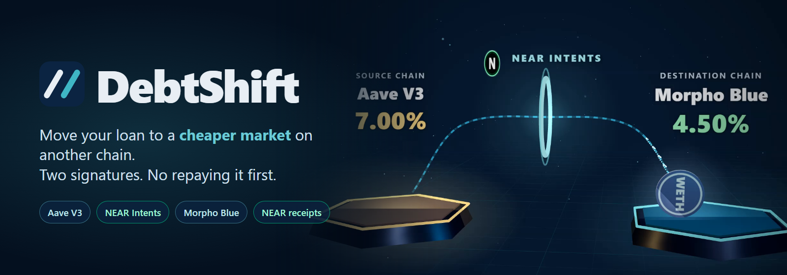
</p>

<p align="center">
  
  
  
  <a href="LICENSE"></a>
</p>

<p align="center">
  
  
  
  
  
  
  
  
</p>

<p align="center">
  <b><a href="#demo">▶ Watch the demo</a></b> ·
  <b><a href="#try-it-in-three-commands-no-wallet-no-docker">Try it in 3 commands</a></b> ·
  <b><a href="#verified-on-public-testnets">Testnet proof</a></b> ·
  <b><a href="#how-near-is-used">How NEAR is used</a></b>
</p>

<h2 id="demo" align="center">Demo</h2>

<p align="center">
  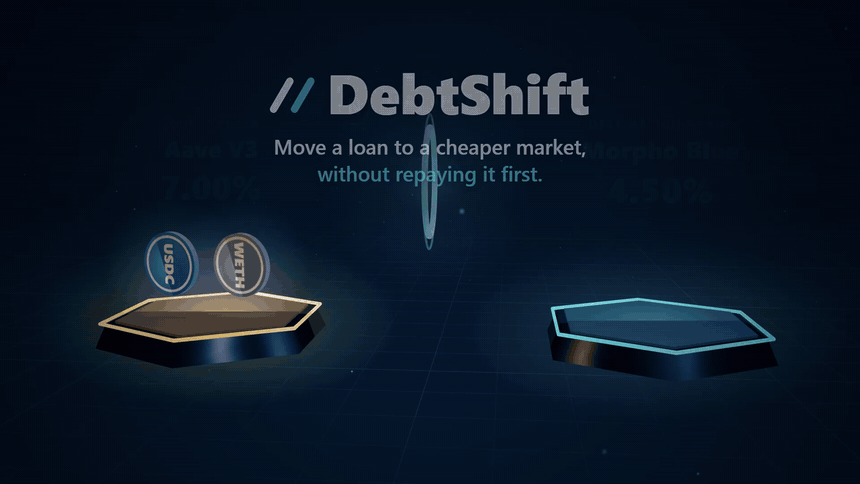
</p>

<!-- Paste the GitHub video link (https://github.com/user-attachments/assets/...) on the next line to show the full demo player here. -->

> **Move a loan to a cheaper market on another chain, with two signatures and without repaying it
> first.** Built at NEAR HACKATHON (November 2026) for the **Unstoppable DeFi** track.

## The problem

The same loan is often cheaper somewhere else. A borrower paying 7.00% on Aave can find 4.50% on
Morpho on another chain, but moving there by hand means finding the full debt in cash first, then
five transactions on two chains: repay, withdraw the collateral, bridge it, deposit it, borrow again.
Most borrowers never do it, and pay the difference every day.

## What DebtShift does

1. **Reads the position** live from the source chain and **compares every candidate market** against
   fixed rules (liquidity, loan-to-value under stress, freshness, every cost). The rejected routes
   show exactly which check failed.
2. **Asks for two signatures** (EIP-712), after a separate sign-in message that authorizes nothing:
   - **the policy**: hard limits any route must respect (maximum debt, maximum total fee, minimum
     rate drop, maximum LTV, slippage, deadline);
   - **the execution plan**: one exact route, with amounts, receivers and refund path. It cannot
     change after signing.
3. **Executes in phases**, each backed by on-chain evidence:
   1. a solver's USDC, held in the DebtShift liquidity vault, is **reserved** for the borrower;
   2. the vault **repays the old loan** and the collateral is released;
   3. the collateral **crosses chains through NEAR Intents** into an escrow fixed by the signed plan;
   4. once delivery is verified, the collateral **opens the new loan**;
   5. the new loan **repays the solver** (principal plus a capped fee) and the vault is reconciled;
   6. the evidence bundle is **recorded in a receipt registry contract on NEAR**. Only then does the
      migration count as `COMPLETED`.
4. **Fails safe.** Cross-chain steps cannot be atomic, and DebtShift does not pretend they are. Before
   the old loan closes, the borrower can cancel. After that, value returns along the refund path they
   signed.

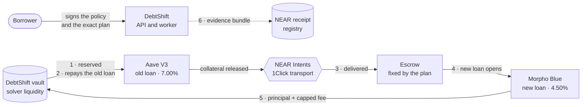

## See it

<table>
  <tr>
    <td width="50%">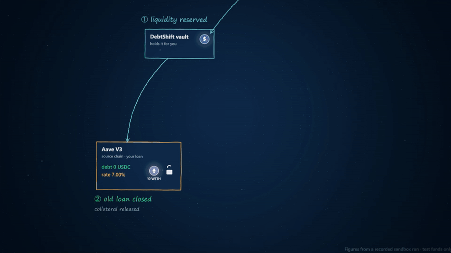<br><sub><b>The mechanism.</b> The collateral crosses through NEAR Intents into an escrow fixed by the signed plan.</sub></td>
    <td width="50%">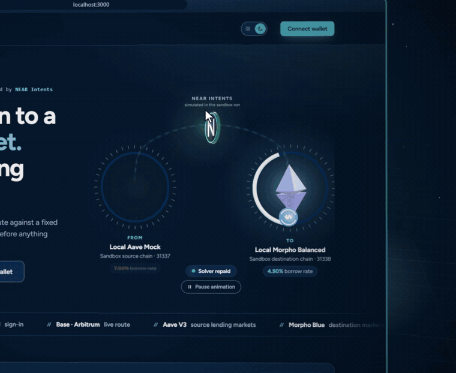<br><sub><b>Your own wallet.</b> Connect, sign in, then two EIP-712 signatures in MetaMask.</sub></td>
  </tr>
</table>

<table>
  <tr>
    <td width="50%">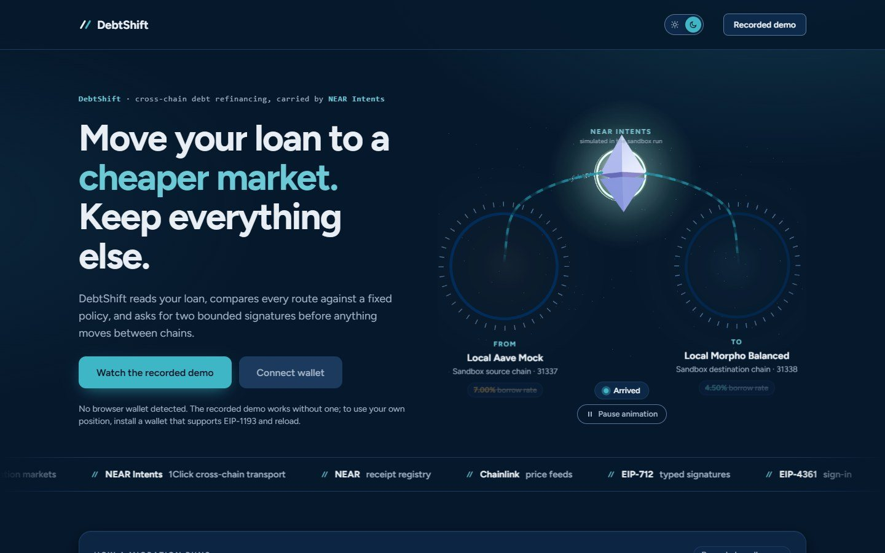<br><sub>Landing page: a live 3D picture of the move (dark mode).</sub></td>
    <td width="50%">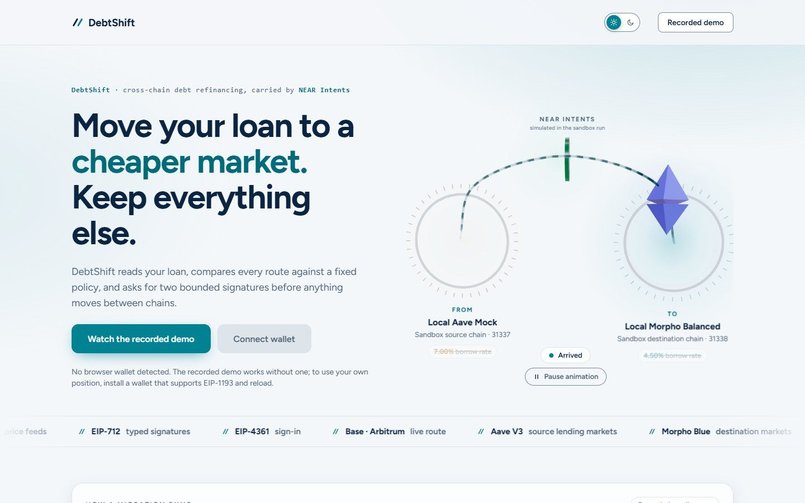<br><sub>The same page in light mode.</sub></td>
  </tr>
  <tr>
    <td>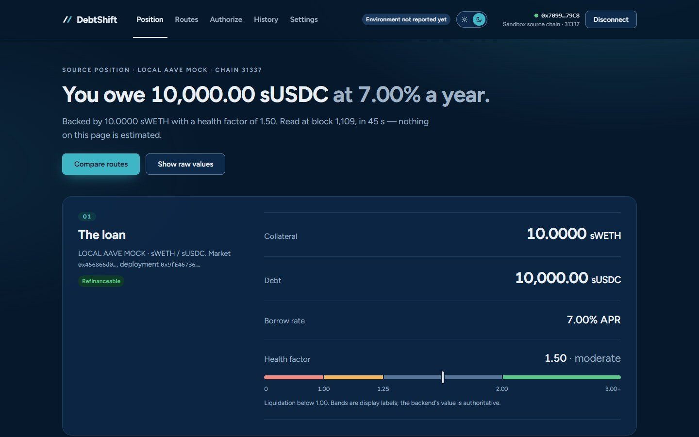<br><sub><b>1 · Position.</b> Read live from the source chain, with the block it was read at.</sub></td>
    <td>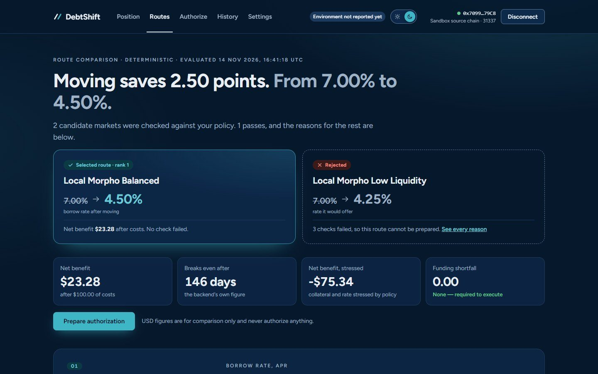<br><sub><b>2 · Routes.</b> Every candidate market checked against your policy; rejections explained.</sub></td>
  </tr>
  <tr>
    <td>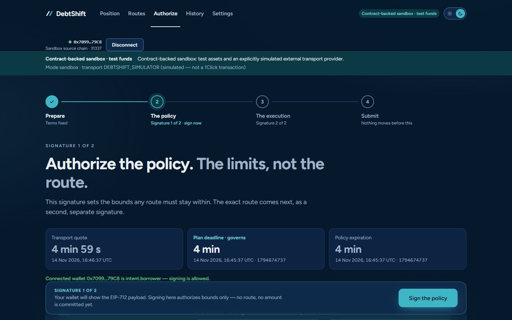<br><sub><b>3 · Authorize.</b> The exact limits, readable before you sign.</sub></td>
    <td align="center">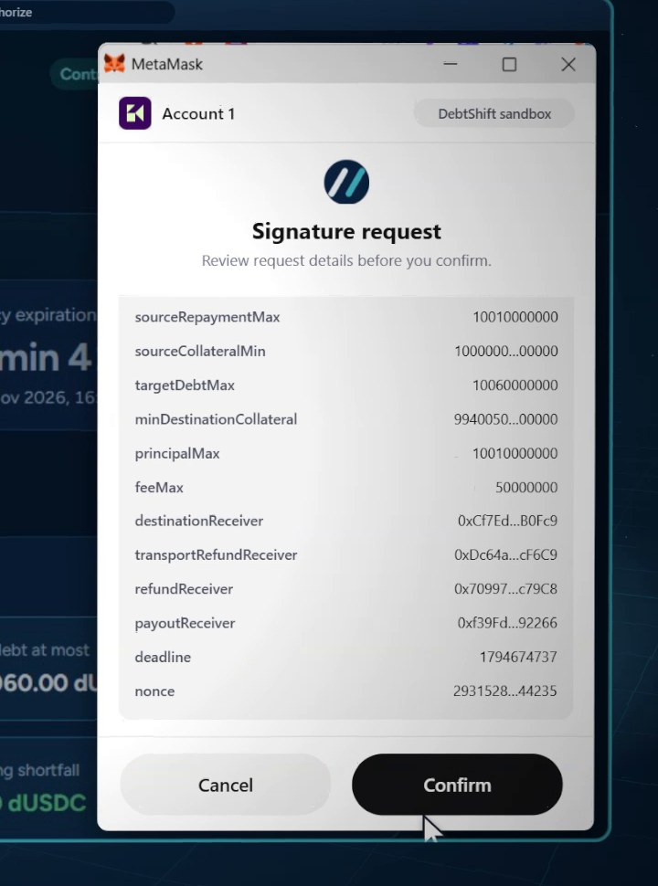<br><sub><b>4 · Sign.</b> The execution plan, field by field, in MetaMask.</sub></td>
  </tr>
  <tr>
    <td>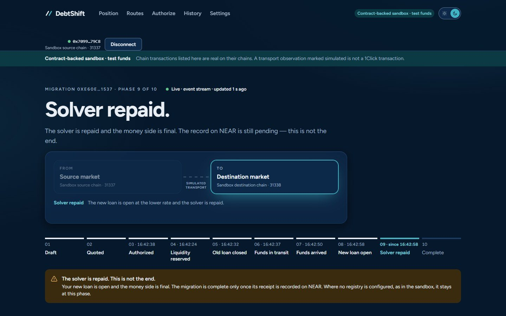<br><sub><b>5 · Watch it run.</b> Every phase streams in live: here the solver is repaid.</sub></td>
    <td>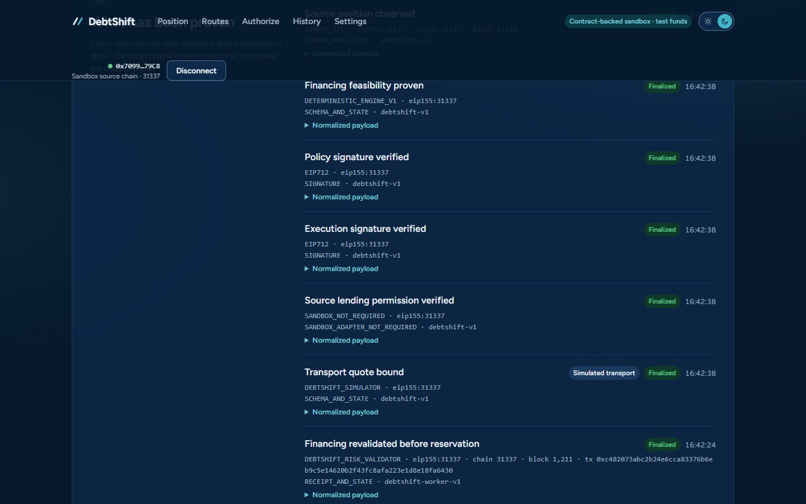<br><sub><b>6 · Evidence.</b> Transaction, block, chain and verification for every step.</sub></td>
  </tr>
</table>

## How NEAR is used

| NEAR component                                    | What it does in DebtShift                                                                                                                                            | Where                                                                                                                                                       |
| ------------------------------------------------- | -------------------------------------------------------------------------------------------------------------------------------------------------------------------- | ----------------------------------------------------------------------------------------------------------------------------------------------------------- |
| **NEAR Intents (1Click)**                         | Cross-chain transport of the collateral between the old and the new loan. Route discovery reads the live 1Click asset catalog to resolve the exact transport assets. | `packages/intents`, `packages/optimizer`                                                                                                                    |
| **NEAR receipt registry** (own near-sdk contract) | Stores each migration's agreement and final evidence bundle. A migration is `COMPLETED` only after its NEAR receipt is verified; until then it is at most `SETTLED`. | `contracts/near/registry`, deployed as [`debtshift-registry-alaa-2026.testnet`](https://testnet.nearblocks.io/address/debtshift-registry-alaa-2026.testnet) |

**What is simulated, stated plainly:** NEAR Intents has no testnet. On the local sandbox and on public
testnets, the 1Click settlement step is simulated and labeled as such everywhere: in the API
(`SIMULATED_1CLICK_BOUNDARY`), in the UI and in the evidence. The transfers around it are real
transactions. Mainnet writes are disabled by default (`MAINNET_EXECUTION_ENABLED=false`).

## Try it in three commands (no wallet, no Docker)

The web app includes a **recorded run**: real responses captured from the contract-backed sandbox
(a real position, route analysis, prepared terms and a settled migration with its evidence),
replayed in the browser. It needs no wallet, no backend and no chains, and every screen labels it as
a recorded run. Requires Node.js 22.

```sh
npm ci
npm run build --workspace @debtshift/domain
npm run dev --workspace @debtshift/web
```

Then, at **http://localhost:3000**:

| Do                                                                         | See                                                                                                                                                                 |
| -------------------------------------------------------------------------- | ------------------------------------------------------------------------------------------------------------------------------------------------------------------- |
| Open the page                                                              | The landing page: a 3D picture of the move (Aave to Morpho through NEAR Intents) and the recorded run's real figures.                                               |
| Click **Watch the recorded demo**                                          | Your position: "You owe 10,000.00 sUSDC at 7.00% a year", backed by 10 sWETH, with the block it was read at.                                                        |
| Click **Compare routes**                                                   | "Moving saves 2.50 points. From 7.00% to 4.50%." One route passes; the rejected one lists the 3 checks it failed.                                                   |
| Click **Prepare authorization**, then the **Prepare authorization** button | The exact terms: limits, amounts and deadlines, readable before signing.                                                                                            |
| Click **Sign the policy**, then **Sign the execution plan**                | "Both signatures collected. Nothing has moved yet." (In the recorded run nothing is signed or sent.)                                                                |
| Click **Replay the recorded migration**                                    | The migration phase by phase, from "Authorized." through "New loan open." to "Solver repaid" (`SETTLED`), with transaction hashes, blocks, evidence and the ledger. |

## Run the full sandbox (real contracts, your own wallet)

This starts PostgreSQL, Redis, two private EVM chains with the contracts deployed, the API, the
worker and the web app. Requires Docker Engine with Compose v2.

```sh
cp .env.example .env
npm ci
npm run infra:up
npm run smoke:local
```

- **Do:** open http://localhost:3000. **See:** the same app, now live against the sandbox. API docs
  are at http://localhost:3001/docs.
- **Do:** `npm run smoke:local` (above). **See:** a signed HTTP-to-chain migration run end to end,
  ending financially final at `SETTLED`. Without NEAR registry credentials, receipt registration
  stays retryable; a credentialed stack reaches `COMPLETED` only after the NEAR receipt is verified.
- **Do:** connect a browser wallet on network `31337` (RPC `http://127.0.0.1:8545`) with Anvil's
  public test account #1. **See:** your own sandbox position, routes, the two EIP-712 signatures in
  your wallet, and the live migration. Each sandbox seed holds one loan.
- **Do:** `npm run demo:happy` and `npm run demo:recovery`. **See:** the dual-chain contract flow, and
  its recovery path, on two disposable Anvil chains.

Stop the stack with `npm run infra:down`. Hot-reload development, observability and database drills
are described under [Development](#development).

## Verified on public testnets

The submission route is deployed from Ethereum Sepolia Aave V3 to Base Sepolia. Its destination is
a DebtShift-operated Morpho Blue-compatible deployment built from pinned canonical source; it is
not represented as an official Morpho testnet deployment. The unavailable NEAR Intents/1Click
testnet boundary remains explicitly simulated while the surrounding source/destination transfers
and protocol evidence use real public-chain transactions.

### Verified debt shift: old Aave position to new Morpho position

The completed public-testnet migration is
`0xece17b2ff0fc8c28c5878e5fccef6cfaf108b3ef99d66f719b1165d151db8475` for borrower
[`0xF4cb...d0d2`](https://sepolia.etherscan.io/address/0xF4cbc06C5295C15f5E308507269dE6fC6Fb9d0d2).
It reached durable phase `COMPLETED` and finalized receipt bundle
`0x46bcf82c8e04a4fdabefadb8c90c03e75c2136a1bfe200c1b2204e4122169166` on NEAR testnet.

The source protocol is the public
[`Aave V3 Sepolia Pool`](https://sepolia.etherscan.io/address/0x6Ae43d3271ff6888e7Fc43Fd7321a503ff738951).
The target is the DebtShift-operated
[`Morpho-compatible Base Sepolia contract`](https://sepolia.basescan.org/address/0x072FB33E63f76479DF0C145F3ebdcc3C241f0771)
and market `0x4505167c540e27ecdb28aacf9977a68e2b3d760022be14a686cbb0f737b3564e`.
The borrower is independently visible on
[`Base Sepolia`](https://sepolia.basescan.org/address/0xF4cbc06C5295C15f5E308507269dE6fC6Fb9d0d2).

Here, the “old” and “new” sides are borrower lending positions. The separate DebtShift liquidity
vault temporarily advances USDC to close the old debt and is reconciled independently below.

| State               | Old position: Aave V3 on Ethereum Sepolia                                                                                                                                                                                                                                                                                                                                                                                                         | New position: Morpho-compatible market on Base Sepolia                                                                                                                                                                                                                                                              |
| ------------------- | ------------------------------------------------------------------------------------------------------------------------------------------------------------------------------------------------------------------------------------------------------------------------------------------------------------------------------------------------------------------------------------------------------------------------------------------------- | ------------------------------------------------------------------------------------------------------------------------------------------------------------------------------------------------------------------------------------------------------------------------------------------------------------------- |
| Before DebtShift    | Supplied exactly `0.01 WETH` in [`0x283d...e44e`](https://sepolia.etherscan.io/tx/0x283d14034977e432e67012d3761b6eed2ba92f50a05c135808b4444cdc51e44e), then borrowed exactly `5 USDC` in [`0xd3d2...9d24`](https://sepolia.etherscan.io/tx/0xd3d2eb49d48f3cc5fa5c1b32016508c489d4f8c4d7d219c1884ce89ba0599d24). The signed source snapshot at block `12,131,216` observed `0.01 WETH` collateral and `5.000058 USDC` variable debt after accrual. | No borrower position was used as the source of funds. The destination market was independently seeded with `10 USDC` in [`0x2618...18b9`](https://sepolia.basescan.org/tx/0x2618d4f88151886d5cf0869abc4f837a78687031f0fce12e20cbf03b96a918b9).                                                                      |
| DebtShift execution | [`0xe1e0...d51`](https://sepolia.etherscan.io/tx/0xe1e0122bfd1e8dcd482567def9134cd1b5d9c0c0eff5fda0a66a8f21afc0bd51) emitted `AavePositionClosed` and `SourceClosed`: `5.000106 USDC` repaid after final accrual and exactly `0.01 WETH` released.                                                                                                                                                                                                | [`0xe803...1a65`](https://sepolia.basescan.org/tx/0xe803e0ab9fbc75b8e801fabda5fce4f2e752bd636412e18c2044e4e70a711a65) emitted `MorphoPositionOpened`: `0.00999 WETH` collateral, `5.000106 USDC` debt, and `5,000,106,000,000` borrow shares. It also emitted the exact `5.000106 USDC` solver payout and zero fee. |
| After DebtShift     | Aave aWETH collateral balance: `0`. Aave variable-USDC debt balance: `0`. The close transaction above is the canonical receipt proving both the repayment and collateral release.                                                                                                                                                                                                                                                                 | Morpho collateral: `0.00999 WETH`. Morpho borrow shares: `5,000,106,000,000`. Destination escrow WETH: `0`; the target-open receipt above proves the collateral supply, borrow, payout, migration ID, plan hash, borrower, and market ID together.                                                                  |

The source debt rose from `5.000058 USDC` at the signed snapshot to `5.000106 USDC` at execution
because Aave variable debt continued accruing. DebtShift repaid that exact live amount and opened
the target with the same `5.000106 USDC` principal. The verified transport delivered `0.00999 WETH`
from the released `0.01 WETH` within the signed route bound.

<details>
<summary><b>DebtShift liquidity-vault reconciliation (before, reserved, after)</b></summary>

The source liquidity vault is
[`0xDC52...8f3E`](https://sepolia.etherscan.io/address/0xDC52C1980c2F69c1152e05D3812d752A0D238f3E).
It is not the borrower’s old or new lending position.

| Checkpoint            | Vault state                                                                                                                | Public proof                                                                                                                                                                                                                                                                     |
| --------------------- | -------------------------------------------------------------------------------------------------------------------------- | -------------------------------------------------------------------------------------------------------------------------------------------------------------------------------------------------------------------------------------------------------------------------------- |
| Before migration      | `10 USDC` balance, `10 USDC` free, `0` reserved, `0` receivable, `0` locked recovery reserve                               | Exact vault deposit in [`0xaff0...31c2`](https://sepolia.etherscan.io/tx/0xaff060fb5e753bdbc78245a38ff581cd213a8e8cf0cacc9b8c9381c6476c31c2)                                                                                                                                     |
| Reserved/source close | Maximum principal `5.005059 USDC`; actual draw `5.000106 USDC`; unused `0.004953 USDC` returned after exact Aave repayment | Reservation [`0x7524...c86`](https://sepolia.etherscan.io/tx/0x7524a461e58243bb478f0626cf54228968d0ee580158212b3db765619e456c86) and source-close events in [`0xe1e0...d51`](https://sepolia.etherscan.io/tx/0xe1e0122bfd1e8dcd482567def9134cd1b5d9c0c0eff5fda0a66a8f21afc0bd51) |
| After settlement      | `10 USDC` balance, `10 USDC` free, `0` reserved, `0` receivable, `0` locked reserve, and zero executor allowance           | [`0xd2b8...b07e`](https://sepolia.etherscan.io/tx/0xd2b82d9f7d81bd0515e5cad887e9c71015ac91d924005341521115648f88b07e) emitted `RecoveryReserveConsumed` and `LiquiditySettled` for exactly `5.000106 USDC`, refunding `0.004953 USDC`                                            |

</details>

<details>
<summary><b>Canonical receipt sequence: all 8 explorer receipts</b></summary>

| Step | Result                                                                  | Explorer receipt                                                                                                      |
| ---: | ----------------------------------------------------------------------- | --------------------------------------------------------------------------------------------------------------------- |
|    1 | Aave source authorization                                               | [`0x4ec5...1b9f`](https://sepolia.etherscan.io/tx/0x4ec5b122d9a1877a74bbfcdf6c01e5ad113ce973c0bdf6ca55b1007b556d1b9f) |
|    2 | Reserve source liquidity                                                | [`0x7524...c86`](https://sepolia.etherscan.io/tx/0x7524a461e58243bb478f0626cf54228968d0ee580158212b3db765619e456c86)  |
|    3 | Repay Aave debt and release source collateral                           | [`0xe1e0...d51`](https://sepolia.etherscan.io/tx/0xe1e0122bfd1e8dcd482567def9134cd1b5d9c0c0eff5fda0a66a8f21afc0bd51)  |
|    4 | Dispatch source collateral                                              | [`0xd63c...41e1`](https://sepolia.etherscan.io/tx/0xd63c68bdb46ec7f59ce38ec3605cada97b3b5d641dfc77f0156a5727c8a241e1) |
|    5 | Register verified destination delivery                                  | [`0x50e4...008c`](https://sepolia.basescan.org/tx/0x50e4b4038e67459f6cc081028216447b76ff660cb84da4f02178e67a64c1008c) |
|    6 | Supply target collateral, borrow target debt, and pay solver atomically | [`0xe803...1a65`](https://sepolia.basescan.org/tx/0xe803e0ab9fbc75b8e801fabda5fce4f2e752bd636412e18c2044e4e70a711a65) |
|    7 | Settle and fully reconcile the source liquidity vault                   | [`0xd2b8...b07e`](https://sepolia.etherscan.io/tx/0xd2b82d9f7d81bd0515e5cad887e9c71015ac91d924005341521115648f88b07e) |
|    8 | Finalize the complete evidence bundle on NEAR testnet                   | [`G9f91...VCCS`](https://testnet.nearblocks.io/txns/G9f91sonXUNaLEB5t15hPoehXT38WTUwmYa4wez2VCCS)                     |

The complete block hashes, evidence IDs, incident history, and final state reconciliation are in
[`strategies-docs/24-public-testnet-workflow-execution.md`](strategies-docs/24-public-testnet-workflow-execution.md).

- Morpho-compatible deployment and 10 test-USDC seed:
  [`deployment/manifests/testnet-morpho-base-sepolia-20261114-v1.json`](deployment/manifests/testnet-morpho-base-sepolia-20261114-v1.json)
- Seven write-disabled DebtShift EVM contracts:
  [`deployment/manifests/testnet-evm-sepolia-base-sepolia-20261114-v3.json`](deployment/manifests/testnet-evm-sepolia-base-sepolia-20261114-v3.json)
- Exact 10 test-USDC source-vault funding with zero residual allowance:
  [`deployment/manifests/testnet-vault-funding-ethereum-sepolia-20261114-v2.json`](deployment/manifests/testnet-vault-funding-ethereum-sepolia-20261114-v2.json)
- Initialized NEAR testnet receipt registry:
  [`deployment/manifests/near-testnet-registry-20261114-v1.json`](deployment/manifests/near-testnet-registry-20261114-v1.json)

All manifests bind source commit, route, identities, receipts, code/state evidence, and a disabled
workflow-write switch. `MAINNET_EXECUTION_ENABLED` remained `false`; these deployments do not enable
mainnet execution.

</details>

## Mainnet-fork proof: automatic route discovery

Production route analysis no longer depends on a configured Morpho market ID. For a connected
wallet, DebtShift enumerates the wallet's active Aave reserves at one canonical block, resolves the
four exact transport assets from the live 1Click catalog, discovers listed Morpho markets for the
supported loan/collateral pair, and verifies every retained market against onchain Morpho state.
The existing deterministic optimizer then applies liquidity, financing, LTV, stress, freshness,
cost, and APR gates before selecting a route. Unknown assets, multiple active Aave collateral/debt
reserves, stable-rate debt, unapproved oracles, and index/onchain disagreements fail closed.

The no-funds dual-mainnet-fork proof passed on 2026-11-14:

- source fork: [Base block 57,337,544](https://basescan.org/block/57337544), where the proof opened
  and then fully closed a 10 WETH / 1,000 USDC Aave V3 position;
- destination fork: [Arbitrum block 524,148,205](https://arbiscan.io/block/524148205);
- automatically selected market:
  `0xca83d02be579485cc10945c9597a6141e772f1cf0e0aa28d09a327b6cbd8642c`;
- observed source APR: `6.90%`; projected destination APR after the borrow: `3.79%`;
- resulting fork position: `9.99 WETH` collateral and `1,000.007970 USDC` debt;
- source Aave position absent after execution, source vault settled, and all checked destination
  adapter/escrow/module residual balances equal to zero.

The complete machine-readable evidence is
[`deployment/evidence/mainnet-fork-route-discovery-proof-20261114.json`](deployment/evidence/mainnet-fork-route-discovery-proof-20261114.json).
Run it again with `npm run proof:mainnet-fork`; it needs Foundry and public RPC access, but no private
key or real funds. The proof reads the live 1Click catalog, while the actual cross-chain 1Click
settlement is explicitly labeled `SIMULATED_1CLICK_BOUNDARY` because an external provider cannot
observe disposable local forks. Its transaction hashes are local-fork evidence, not mainnet
explorer receipts. `MAINNET_EXECUTION_ENABLED` remains `false` throughout.

## Runtime modes

DebtShift has one provider-neutral refinance workflow. The contract-backed sandbox and public
testnet exercise that workflow through mode-specific adapters; they are not separate simulated
business implementations. The sandbox executes real private-chain contracts and transactions and
simulates only the unavailable external 1Click testnet boundary. Mainnet targets the complete
Aave-to-1Click-to-Morpho workflow, not an isolated transport canary.

The four runtime modes are `sandbox`, `testnet`, `mainnet-readonly`, and `mainnet`.
`mainnet-readonly` requires a complete runtime market registry and direct Aave, Morpho, Chainlink,
and authenticated 1Click reads. Production modes cannot fall back to fixture values. Mainnet writes
additionally require the restart-bound server switch `MAINNET_EXECUTION_ENABLED=true`; it defaults
to `false`. See `strategies-docs/12-production-provider-boundaries.md` for the enforced boundary.

## Repository

- `apps/web`: Next.js borrower dashboard.
- `apps/api`: NestJS REST and SSE control-plane API.
- `apps/worker`: durable command, evidence, and recovery worker.
- `packages/*`: domain, persistence, optimizer, agent, protocol, transport, and SDK modules.
- `contracts/evm`: Foundry workspace for bounded migration contracts and test markets.
- `contracts/near`: near-sdk workspace for the agreement and receipt registry.
- `infra`: local services, monitoring, and deployment assets.
- `strategies-docs`: approved scope, architecture, security rules, roadmap, and completion gates.

## Built during NEAR HACKATHON

The repository's history starts on 2026-11-09, inside the hackathon window (from the announcement
on 2026-10-19 to 2026-11-14); every commit is part of the judged work.

Open-source libraries and tools used: Next.js, React, three.js, GSAP and Lenis (web); NestJS,
BullMQ, ioredis, Drizzle ORM, node-postgres and zod (API and worker); viem (EVM);
near-api-js and near-sdk (NEAR); Foundry (EVM contracts); PGlite and Vitest (tests); Turborepo
(monorepo). The testnet Morpho-compatible market is built from pinned canonical Morpho Blue
source.

## Development

### Prerequisites

- Node.js 22.16.0 and npm 10.9.2.
- Docker Engine with Docker Compose v2.
- Foundry 1.9.0 for EVM contract work.
- Rust 1.95.0, `wasm32-unknown-unknown`, and near-sdk tooling for the NEAR contract.

Only Node and Docker are required for the initial TypeScript workspace. Contract-specific setup is
documented in `docs/local-setup.md`.

### Full stack, hot reload and quality gates

The one-command sandbox is described in
[Run the full sandbox](#run-the-full-sandbox-real-contracts-your-own-wallet). It also serves
Prometheus text metrics at `http://localhost:3001/v1/metrics`.
The checked-in OpenAPI 3.1 contract is `docs/openapi.json`; deterministic operation, request, and
response types are exported by `@debtshift/sdk`. Run `npm run openapi:generate` after changing an API
contract, or `npm run openapi:check` to reject generated-artifact drift.
An authorized migration is placed in the page URL as `?migration=0x...`, so reload restores its
durable timeline, evidence, ledger, and recovery state. Live updates use the cursor-resumable
`GET /v1/migrations/:migrationId/stream` SSE endpoint and fall back to the last PostgreSQL audit
sequence after a disconnect.

Start the same stack with the optional local observability profile using:

```sh
npm run infra:observability:up
```

This selects the local OTLP collector for the API and worker, provisions Prometheus and the
read-only DebtShift Grafana dashboard, and starts Jaeger. Grafana is bound to
`http://127.0.0.1:3002`, Prometheus to `http://127.0.0.1:9090`, and Jaeger to
`http://127.0.0.1:16686`. Use `npm run infra:observability:down` to stop the profile. Tracing is a
deployment-selected feature and remains a no-op when `OTEL_EXPORTER_OTLP_ENDPOINT` is blank.
Only W3C trace context and reviewed low-risk attributes are emitted; request bodies, wallet
signatures, provider payloads, credentials, and raw URLs are excluded.

Connecting a wallet also proves API identity through a five-minute, one-time EIP-4361 challenge.
The API returns an eight-hour opaque `HttpOnly`, `SameSite=Strict` session cookie and persists only
its SHA-256 hash. This login signature is not financial authorization: refinance execution still
requires the separate bounded intent and exact execution-plan EIP-712 signatures. All borrower and
migration routes are scoped to the authenticated wallet; production public URLs must use HTTPS.

For application hot reload instead, start only the service dependencies:

```sh
npm run infra:dependencies
npm run db:migrate --workspace @debtshift/database
npm run local:chains # keep this terminal open
```

Then start the applications in another terminal:

```sh
npm run dev
```

Run all currently enabled quality gates with:

```sh
npm run check
```

With Foundry, Rust, and cargo-near installed, run the complete workspace gate with:

```sh
npm run check:all
```

Public-testnet release operations are separately gated. Run the keyless account/funding inventory
with `npm run check:public-testnet-funding`; after canonical Morpho and DebtShift EVM deployment,
use the exact guarded `npm run fund:testnet-vault` operation and remove its key before running
`npm run check:testnet-vault-funding`. These commands do not enable workflow or mainnet writes. The
required ordering, manifests, approvals, recovery rules, and evidence are documented in
`strategies-docs/22-public-testnet-funding-readiness.md` and
`strategies-docs/23-testnet-vault-funding.md`.

Run the reproducible dual-chain contract demonstrations with:

```sh
npm run demo:happy
npm run demo:recovery
```

Each command starts and stops two private Anvil chains and uses disposable test assets only.
`npm run smoke:local` targets the running full sandbox and submits a signed HTTP-to-chain migration.
Without NEAR registry credentials the local development stack reaches financially final `SETTLED`
and keeps receipt registration retryable; a credentialed hosted stack reaches `COMPLETED` only
after the registry receipt is verified.

Exercise the PostgreSQL recovery controls against isolated sibling databases with:

```sh
npm run ops:drill:database-restore
npm run ops:drill:database-migration-recovery
```

The first command verifies an exact source backup/restore without mutating the source. The second
starts from an empty disposable database, applies every checked-in migration, proves transactional
DDL rollback, applies a forward candidate, restores the pre-change backup, and proves that the
checked-in migrator remains idempotent. Neither command points a worker at its temporary database.

## Safety boundary

No real or funded borrower private key belongs in this repository or backend; only Foundry's
well-known disposable Anvil keys are used for local tests. Mainnet writes are fail-closed by default
and the first bounded transaction requires the documented verification gates and explicit financial
authorization. The default Route/Risk Agent is deterministic and requires no AI service.
Optional local or user-supplied AI providers can explain an already-computed result but cannot rank
routes, alter signed fields, or invoke execution.

The solver-financing architecture also requires a zero-shortfall proof before temporary liquidity is
committed: safe destination borrowing plus finalized supplementary funding must cover principal,
solver fees, and every financed cost. Cross-chain smart contracts bound custody and actions but do
not make the migration atomic or guarantee solver repayment. The exact model and recovery rules are
defined in `strategies-docs/11-refinancing-feasibility-model.md` and remain part of the production
implementation and verification gates.

See `strategies-docs/README.md` for the implementation source of truth.

## Team

- **Ala** ([@alaasouabni](https://github.com/alaasouabni)): Web3 developer and software engineer.
- **Firas** ([@firasbelhiba](https://github.com/firasbelhiba)): Web3 developer and software engineer.

## License

[MIT](LICENSE).
